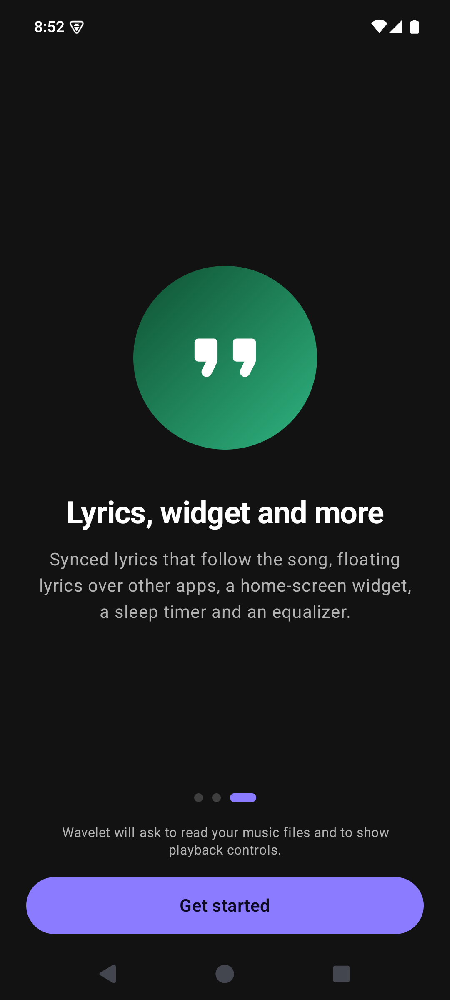
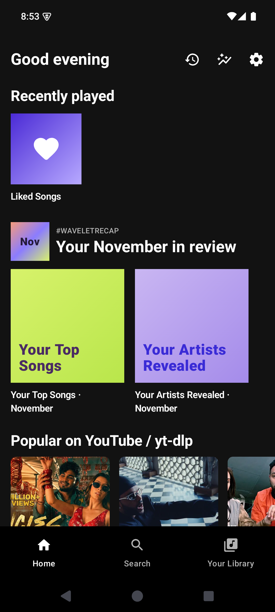
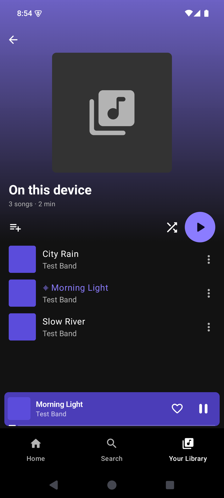
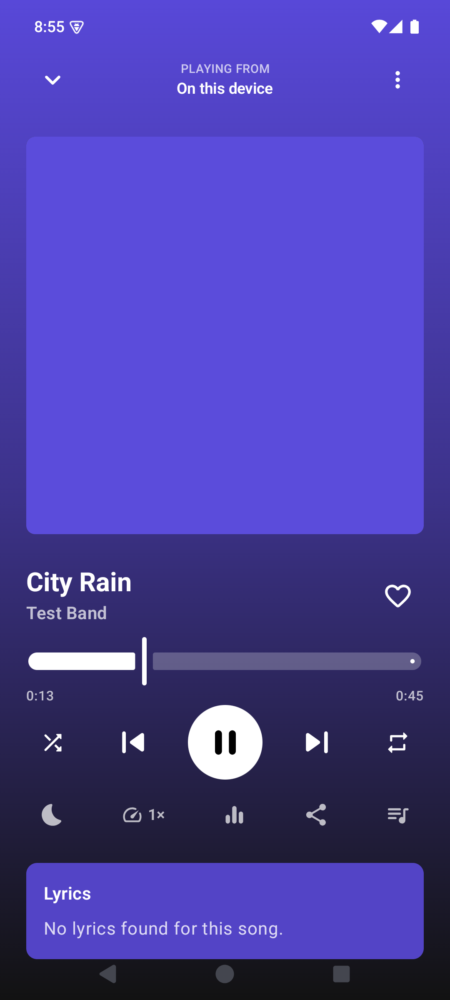
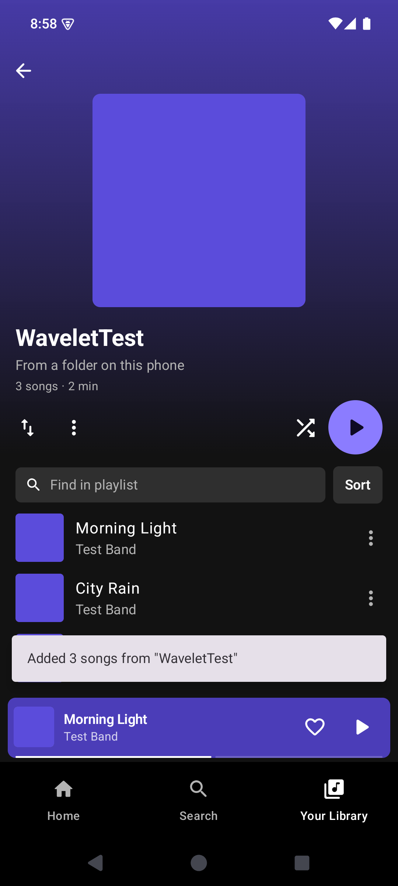
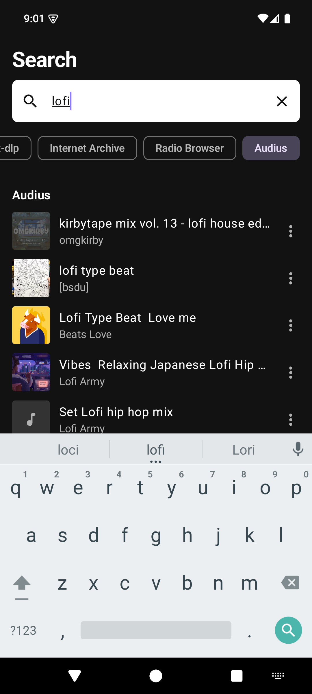

# Wavelet

An open-source Android music player (Kotlin + Jetpack Compose) with a Spotify-style UI: dark-first theme, Home / Search / Your Library tabs, and artwork-tinted Now Playing. Built around pluggable **sources** listed in a repo index — add local files, internet radio, Jamendo, Navidrome/Subsonic, Jellyfin, Plex, and more.

Written from scratch; no Soundbound or Spotify code is used. The Spotify Mobile UI Kit was used only as a visual reference — Wavelet has its own design and violet accent (#8B7CFF).

## Download

[](https://github.com/sololevel070/wavelet/releases/latest/download/Wavelet-debug.apk)

[](https://github.com/sololevel070/wavelet/releases)

> Install the latest debug build directly. Enable "Install from unknown sources" on your device before installing.

## Screenshots

| Welcome | Home | On This Device |
|---------|------|----------------|
|  |  |  |

| Now Playing | Folder Playlist | Search |
|-------------|-----------------|--------|
|  |  |  |

The UI follows a Spotify-style layout: bottom navigation (Home, Search, Your Library), artwork-tinted Now Playing and mini player, and a dark-first theme with violet (#8B7CFF) accents.

## Features

**Library**
- Playlists: create, rename, describe, reorder, remove songs, delete
- Liked Songs, Downloads, On this device, Albums and Artists views
- Import playlists from CSV (Exportify/Spotify, TuneMyMusic, Soundiiz), M3U/M3U8, XSPF, JSPF, Wavelet JSON and ListenBrainz
- All file imports (M3U/M3U8/XSPF/CSV/Wavelet JSON/JSPF) are matched against your sources with near-100% accuracy so matched songs play directly; unmatched songs stay grayed as "Not found" and can be fixed via the "Fix match" picker or "Re-scan"
- Link imports (Spotify, YouTube, ListenBrainz) match songs to your sources the same way
- Export playlists as Wavelet JSON, M3U8, CSV or XSPF (server login tokens are never written out), or share as text
- Backup and restore of playlists, likes, history and sources (passwords and tokens are left out)

**Folders, ZIP and flow (v0.4)**
- Library › + › "Add music folder": pick any folder (sub-folders included) and it becomes a playlist; "Sync folder" adds songs added later
- Playlist menu › "Export as ZIP": the songs stored on the phone plus a playlist file (M3U8), a CSV song list and not-included.txt
- "Re-scan" retries matching for imported songs marked "Not found"
- Bottom tabs always open on their main screen; Settings, playlists etc. open above the tab they came from; back from Search/Library returns to Home
- A tapped song shows a spinner on its row and in the mini player until it plays; skeleton placeholders while shelves and search results load
- System splash screen (animated icon), a 3-page welcome tour on first launch, an About screen, and 300 ms Material-style transitions (fade-through between tabs, shared-axis slide for deeper screens)

**Playback**
- Background playback with notification, lock-screen and headset controls (Media3)
- Shuffle, repeat (all/one), queue editor (reorder, remove, clear upcoming), play next / add to queue
- Sleep timer (minutes or end of song), playback speed, system equalizer
- Offline downloads (only where the source allows), preferred over streaming when present
- Synced, tappable lyrics (LRCLIB)
- "Open in…" links: the exact Apple Music track (iTunes Search API) plus search links for Spotify, YouTube Music, Deezer, Tidal and Amazon Music

**Floating lyrics, widget and resume**
- Floating lyrics: a draggable bubble over other apps showing the current and next synced line (Settings › Floating lyrics; needs "Display over other apps")
- Home-screen widget with artwork, song and previous / play-pause / next
- The queue and position are saved; Wavelet reopens where you left off, and the widget or a headset can resume playback after the app was closed
- "Go to radio": a mix of songs by the same artist from your library and sources
- Recent searches

**Listening**
- Recently played, monthly recap (minutes, plays, top songs, top artist)
- ListenBrainz scrobbling ("playing now" and listens) and playlist import

**Design**
- Home with greeting, quick picks, "Jump back in", shelves per source and a monthly recap card
- Search with browse tiles and per-source filters; Your Library with filters and sorting
- Now Playing and the mini player tinted with the artwork's colours; dark, light or system theme; Material You optional

## Sources

| Source | Provides | Notes |
|---|---|---|
| On this device | Music files on the phone | Needs the music permission |
| Downloads | Tracks saved in Wavelet | Plays offline |
| Internet Archive | Concerts, netlabels, public domain | Music collections only; each result is an item and plays its first audio file |
| Radio Browser | ~50k internet radio stations | Live, not downloadable |
| Jamendo | Creative Commons music | Free client ID from devportal.jamendo.com |
| Navidrome / Subsonic | Your own server | Salted-token auth, add as many servers as you like |
| Jellyfin | Your own server | Username + password |
| Plex | Your own server | Server URL + X-Plex-Token |
| LRCLIB | Synced lyrics | |
| Song links | Links to other services | Only called when you tap the link button. Odesli was dropped: its public API closed in 2026 |

Streaming sites that don't offer an official playback API (YouTube, Spotify, SoundCloud,
JioSaavn, Gaana) are intentionally not included.

## Repos

A repo is a JSON file you host anywhere. See [repo/sources.json](repo/sources.json):

```json
{
  "name": "My repo",
  "sources": [
    { "id": "family-navidrome", "engine": "subsonic", "name": "Family Navidrome",
      "version": "1.0", "options": { "url": "https://music.example.com" } }
  ]
}
```

`engine` must be one of the built-in engines: `local`, `downloads`, `jamendo`,
`internet_archive`, `radio_browser`, `subsonic`, `jellyfin`, `lrclib`, `songlink`.
Repos can only enable and configure built-in code, so installing a repo never runs
downloaded code on the phone. Missing options (API keys, passwords) are asked for on install.

## Adding a new source engine

1. Implement `MusicSource`, `LyricsSource` or `LinkSource` (see `source/Source.kt`) in `source/impl/`.
2. Register it in `source/Engines.kt` (`all` for its settings, `create` to build it).

## Building

Requirements: JDK 17 and the Android SDK (platform 35). The easiest route is Android Studio:
open this folder and press Run.

From the command line, with the SDK installed and `ANDROID_HOME` set:

```bash
gradle wrapper --gradle-version 8.11.1   # once, if gradlew is missing
./gradlew assembleDebug
```

The APK lands in `app/build/outputs/apk/debug/app-debug.apk`.

## Code map

```
app/src/main/java/app/wavelet/
  WaveletApp.kt          app container (store, sources, downloads, repos)
  data/AppStore.kt       saved settings (sources, repos, preferences) as JSON
  data/db/               Room database: playlists, likes, history, track cache
  data/LibraryRepository playlists, likes, history, stats, backup
  io/                    playlist file formats and the song matcher
  integrations/          ListenBrainz
  net/Http.kt            OkHttp client and JSON helpers
  source/                source API, engine registry, repo loader
  source/impl/           one file per source
  download/              offline downloads
  player/                PlaybackService (ExoPlayer + MediaSession) and controller
  ui/                    Compose screens: Home, Search, Library, Playlist, Now Playing, Settings, Stats, Import
```

## Known limits (v0.3)

- Server passwords are stored in app-private storage, not encrypted.
- Internet Archive results are whole items; per-track browsing isn't built yet.
- Not built yet: live sync with Spotify/YouTube Music/Apple Music accounts, song recognition, drag-and-drop reordering (use the up/down buttons).

## Tests

```bash
./gradlew testDebugUnitTest
```

Covers playlist import/export (CSV, M3U, JSPF, Wavelet JSON), token stripping on export, song matching and LRC parsing.

## Contributing

Wavelet is open for public contributions. Fork the repo, create a branch, and open a pull request. Please keep UI copy plain and short (sentence case), and don't ship downloaded plugin code — repos only enable built-in engines.

## License

MIT License
